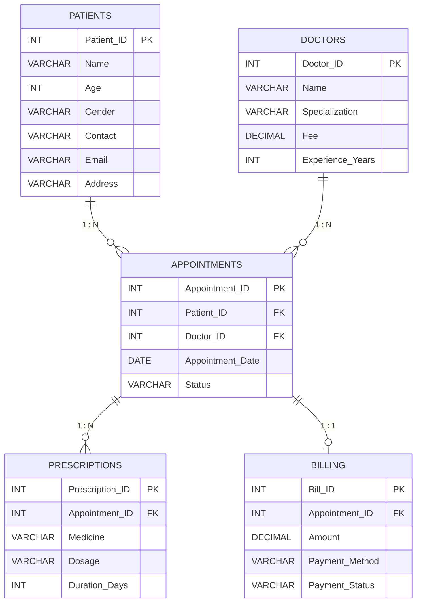

# MediTrack 🏥

> A relational healthcare management database built with **MySQL** for managing patients, doctors, appointments, prescriptions, and billing.

---

## 📌 Overview

**MediTrack** is a MySQL-based healthcare management system designed to demonstrate relational database concepts and SQL operations.

The database contains five core entities:

- **Patients** — stores patient information
- **Doctors** — stores doctor and specialization details
- **Appointments** — connects patients with doctors
- **Prescriptions** — stores medicines prescribed during appointments
- **Billing** — manages appointment payment information

---

## 🛠️ Tech Stack

| Technology | Usage |
|---|---|
| MySQL 9.7 | Database |
| MySQL Shell | SQL execution |
| SQL | Database queries |
| GitHub | Version control & documentation |

---

## 🗂️ Database Schema

```text
MediTrack
│
├── Patients
│   └── Patient_ID (PK)
│
├── Doctors
│   └── Doctor_ID (PK)
│
├── Appointments
│   ├── Appointment_ID (PK)
│   ├── Patient_ID (FK)
│   └── Doctor_ID (FK)
│
├── Prescriptions
│   ├── Prescription_ID (PK)
│   └── Appointment_ID (FK)
│
└── Billing
    ├── Bill_ID (PK)
    └── Appointment_ID (FK)
```

---

# 🔗 ER Diagram

The following Entity-Relationship diagram represents the structure and relationships between the five tables in the MediTrack database.



---

## 🔄 Relationships

| From | To | Relationship | Description |
|---|---|---|---|
| Patients | Appointments | **1 : N** | One patient can have multiple appointments |
| Doctors | Appointments | **1 : N** | One doctor can handle multiple appointments |
| Appointments | Prescriptions | **1 : N** | One appointment can have multiple prescriptions |
| Appointments | Billing | **1 : 1** | One appointment has one billing record |

### Relationship Summary

```text
Patients      1 ─────────── N  Appointments
Doctors       1 ─────────── N  Appointments
Appointments  1 ─────────── N  Prescriptions
Appointments  1 ─────────── 1  Billing
```

### Relationship Explanation

**Patients → Appointments — 1 : N**

One patient can have multiple appointments.

**Doctors → Appointments — 1 : N**

One doctor can handle multiple appointments.

**Appointments → Prescriptions — 1 : N**

One appointment can have multiple prescription records.

**Appointments → Billing — 1 : 1**

One appointment is associated with one billing record.

> **Note:** The current `Billing` design is intended as a 1:1 relationship. To enforce this relationship at the database level, `Billing.Appointment_ID` should be `UNIQUE`.

```sql
ALTER TABLE Billing
ADD CONSTRAINT UQ_Billing_Appointment
UNIQUE (Appointment_ID);
```

---

# 🏗️ Database Architecture

```text
                         ┌─────────────────┐
                         │     PATIENTS    │
                         │─────────────────│
                         │ Patient_ID (PK) │
                         │ Name            │
                         │ Age             │
                         │ Gender          │
                         │ Contact         │
                         │ Email           │
                         │ Address         │
                         └────────┬────────┘
                                  │
                                  │ Patient_ID
                                  │ 1 : N
                                  ▼
                         ┌─────────────────────┐
                         │    APPOINTMENTS     │
                         │─────────────────────│
                         │ Appointment_ID (PK) │
                         │ Patient_ID (FK)     │
                         │ Doctor_ID (FK)      │
                         │ Appointment_Date    │
                         │ Status              │
                         └──────┬───────┬──────┘
                                │       │
                         1 : N  │       │  1 : N
                                │       │
                                ▼       ▼
                    ┌────────────────┐  ┌─────────────────┐
                    │ PRESCRIPTIONS  │  │     DOCTORS     │
                    │────────────────│  │─────────────────│
                    │Prescription_ID │  │ Doctor_ID (PK)  │
                    │     (PK)       │  │ Name            │
                    │Appointment_ID  │  │ Specialization  │
                    │     (FK)       │  │ Fee             │
                    │ Medicine       │  │ Experience      │
                    │ Dosage         │  └─────────────────┘
                    │ Duration_Days  │
                    └────────────────┘

                                │
                                │ Appointment_ID
                                │ 1 : 1
                                ▼
                       ┌─────────────────────┐
                       │       BILLING       │
                       │─────────────────────│
                       │ Bill_ID (PK)        │
                       │ Appointment_ID (FK) │
                       │ Amount              │
                       │ Payment_Method      │
                       │ Payment_Status      │
                       └─────────────────────┘
```

---

# 📋 Tables

## Patients

Stores patient details.

| Column | Type | Key |
|---|---|---|
| `Patient_ID` | INT | PK |
| `Name` | VARCHAR(100) | |
| `Age` | INT | |
| `Gender` | VARCHAR(10) | |
| `Contact` | VARCHAR(15) | |
| `Email` | VARCHAR(100) | |
| `Address` | VARCHAR(100) | |

---

## Doctors

Stores doctor details.

| Column | Type | Key |
|---|---|---|
| `Doctor_ID` | INT | PK |
| `Name` | VARCHAR(100) | |
| `Specialization` | VARCHAR(50) | |
| `Fee` | DECIMAL(10,2) | |
| `Experience_Years` | INT | |

---

## Appointments

Connects patients and doctors.

| Column | Type | Key |
|---|---|---|
| `Appointment_ID` | INT | PK |
| `Patient_ID` | INT | FK |
| `Doctor_ID` | INT | FK |
| `Appointment_Date` | DATE | |
| `Status` | VARCHAR(20) | |

---

## Prescriptions

Stores prescribed medicines.

| Column | Type | Key |
|---|---|---|
| `Prescription_ID` | INT | PK |
| `Appointment_ID` | INT | FK |
| `Medicine` | VARCHAR(100) | |
| `Dosage` | VARCHAR(20) | |
| `Duration_Days` | INT | |

---

## Billing

Stores payment information.

| Column | Type | Key |
|---|---|---|
| `Bill_ID` | INT | PK |
| `Appointment_ID` | INT | FK |
| `Amount` | DECIMAL(10,2) | |
| `Payment_Method` | VARCHAR(50) | |
| `Payment_Status` | VARCHAR(20) | |

---

# 📊 Sample Data

| Table | Records |
|---|---:|
| Patients | 20 |
| Doctors | 15 |
| Appointments | 10 |
| Prescriptions | 13 |
| Billing | 10 |

---

# 🚀 Getting Started

## 1. Clone the Repository

```bash
git clone https://github.com/your-username/MediTrack-MySQL.git
cd MediTrack-MySQL
```

## 2. Open MySQL Shell

Connect to your MySQL server:

```sql
\connect root@localhost:3306
```

## 3. Create the Database

```sql
CREATE DATABASE MediTrack;
USE MediTrack;
```

## 4. Run the SQL File

If the repository contains `MediTrack.sql`:

```sql
SOURCE MediTrack.sql;
```

Or execute the SQL commands manually in this order:

```text
1. Create Patients
2. Insert Patients
3. Create Doctors
4. Insert Doctors
5. Create Appointments
6. Insert Appointments
7. Create Prescriptions
8. Insert Prescriptions
9. Create Billing
10. Insert Billing
```

---

# 🔍 Example Queries

## View All Patients

```sql
SELECT * FROM Patients;
```

## View All Doctors

```sql
SELECT * FROM Doctors;
```

## Find Patients Above 40 Years Old

```sql
SELECT *
FROM Patients
WHERE Age > 40;
```

## Find Doctors With More Than 10 Years of Experience

```sql
SELECT *
FROM Doctors
WHERE Experience_Years > 10;
```

## Find Appointments After January 8, 2024

```sql
SELECT *
FROM Appointments
WHERE Appointment_Date > '2024-01-08';
```

---

# 🔗 JOIN Example

Get patient, doctor, specialization, and appointment information:

```sql
SELECT
    Patients.Name AS Patient_Name,
    Doctors.Name AS Doctor_Name,
    Doctors.Specialization,
    Appointments.Appointment_Date,
    Appointments.Status
FROM Appointments
JOIN Patients
    ON Appointments.Patient_ID = Patients.Patient_ID
JOIN Doctors
    ON Appointments.Doctor_ID = Doctors.Doctor_ID;
```

---

# 💊 Prescription Query

```sql
SELECT
    Patients.Name AS Patient_Name,
    Prescriptions.Medicine,
    Prescriptions.Dosage,
    Prescriptions.Duration_Days
FROM Prescriptions
JOIN Appointments
    ON Prescriptions.Appointment_ID = Appointments.Appointment_ID
JOIN Patients
    ON Appointments.Patient_ID = Patients.Patient_ID;
```

---

# 💳 Billing Query

```sql
SELECT
    Patients.Name AS Patient_Name,
    Billing.Amount,
    Billing.Payment_Method,
    Billing.Payment_Status
FROM Billing
JOIN Appointments
    ON Billing.Appointment_ID = Appointments.Appointment_ID
JOIN Patients
    ON Appointments.Patient_ID = Patients.Patient_ID;
```

---

# 🔐 Keys & Constraints

## Primary Keys

```text
Patients       → Patient_ID
Doctors        → Doctor_ID
Appointments   → Appointment_ID
Prescriptions  → Prescription_ID
Billing        → Bill_ID
```

## Foreign Keys

```text
Appointments.Patient_ID
        ↓
Patients.Patient_ID

Appointments.Doctor_ID
        ↓
Doctors.Doctor_ID

Prescriptions.Appointment_ID
        ↓
Appointments.Appointment_ID

Billing.Appointment_ID
        ↓
Appointments.Appointment_ID
```

---

# 🧠 SQL Concepts Covered

- Database creation
- Table creation
- Primary Keys
- Foreign Keys
- Referential Integrity
- One-to-One relationships
- One-to-Many relationships
- `INSERT`
- `SELECT`
- `WHERE`
- `JOIN`
- Data filtering
- Relational database design
- Data types
- Constraints

---

# 📁 Project Structure

```text
MediTrack-MySQL/
│
├── README.md
├── MediTrack.sql
│
└── screenshots/
    ├── patients.png
    ├── doctors.png
    ├── appointments.png
    ├── prescriptions.png
    └── billing.png
```

---

# 🎯 Learning Objectives

This project was created to practice:

1. Designing a relational database
2. Creating tables and relationships
3. Using primary and foreign keys
4. Working with one-to-many relationships
5. Understanding one-to-one relationships
6. Inserting and retrieving data
7. Writing SQL queries
8. Using `JOIN` operations
9. Maintaining referential integrity

---

# 👨‍💻 Author

**Raj Gupta**

B.Tech — Computer Science & Engineering

---

# 📌 Project Status

**Status:** 🟢 Completed

This project was developed for **SQL and database learning purposes**.

---

# 📜 License

This project is intended for educational and learning purposes.
